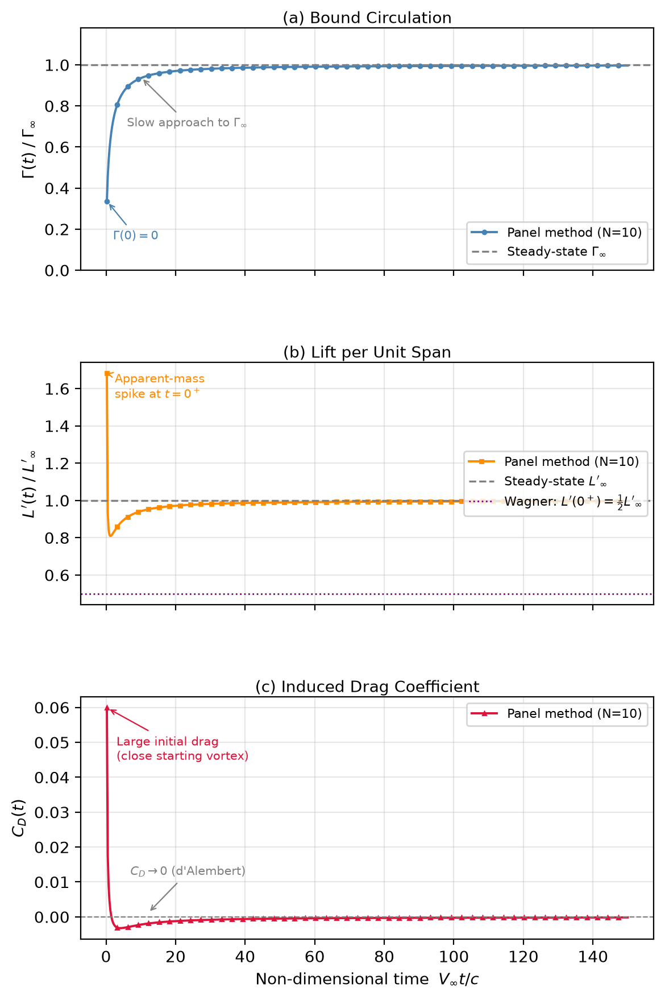

# Unsteady Vortex Panel Method

A computational aerodynamics project completed for **AE221: Aerodynamics** at the Indian Institute of Science (IISc) in 2024.

## Overview

This project investigates the impulsive start of a two-dimensional flat plate using an unsteady vortex panel method.

The flat plate is initially at rest and is suddenly accelerated to a free-stream velocity of 40 m/s at an angle of attack of 5°.

The simulation computes the time evolution of:

- Bound circulation, Γ(t)
- Unsteady lift per unit span, L′(t)
- Induced drag coefficient, C_D(t)

## Simulation Results

The following plots show the time evolution of bound circulation,
unsteady lift, and induced drag obtained from the vortex panel method.

  

## Methodology

The implementation follows the formulation presented in Katz and Plotkin, *Low-Speed Aerodynamics*, Section 13.8.

Key elements include:

- Discretization of the flat plate into bound-vortex panels
- Placement of bound vortices at quarter-chord positions and enforcement of the no-penetration boundary condition at three-quarter-chord collocation points
- Discrete wake-vortex modelling
- Enforcement of Kelvin's circulation theorem
- Numerical solution of the resulting linear system at each time step
- Calculation of unsteady lift, including circulatory and apparent-mass contributions
- Calculation of induced drag from wake-induced downwash and the apparent-mass contribution
- Visualization of transient aerodynamic loads and their steady-state limits

## Simulation Parameters

| Parameter | Value |
|---|---:|
| Angle of attack | 5° |
| Free-stream velocity | 40 m/s |
| Chord length | 1 m |
| Air density | 1.225 kg/m³ |
| Number of panels | 10 |
| Non-dimensional time step, \(\Delta \tau\) | 0.25 |
| Number of time steps | 600 |

## Results

The simulation examines three aspects of the unsteady aerodynamic response:

- **Bound circulation:** Gradual development towards the steady-state thin-airfoil prediction as the starting vortex convects downstream.
- **Unsteady lift:** An initial apparent-mass contribution followed by recovery towards the steady-state lift.
- **Induced drag:** Transient drag associated with wake-induced downwash and the apparent-mass contribution, which diminishes as the unsteady effects decay.

The accompanying report presents the theoretical derivation, numerical results, plots, and discussion of the physical behaviour.

## Reference

Katz, J. and Plotkin, A. *Low-Speed Aerodynamics*, 2nd edition, Cambridge University Press, 2001, Section 13.8.

## Academic Context

AE221 Aerodynamics — Term Paper, Part 1, Question 2.

This repository documents coursework completed as part of my undergraduate studies. The report and implementation are shared subject to applicable course policies.
